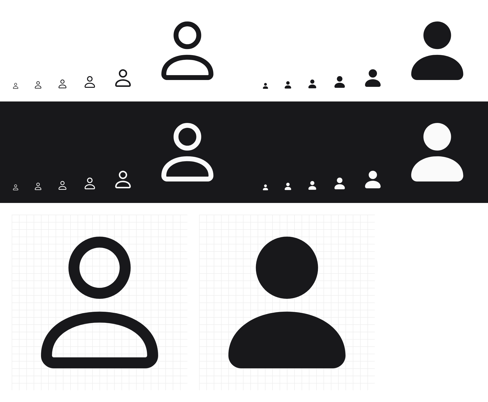

# Glyph

Clean, consistent SVG icons in two styles: **outline** and **solid**.

| Icon   | Outline                      | Solid                      |
| ------ | ---------------------------- | -------------------------- |
| `user` |   |   |



## Using the icons

Every icon is a plain SVG that inherits its color from `currentColor`, so it takes on the surrounding text color. Set the size with CSS or `width`/`height`.

**Raw files.** Copy them from `icons/outline/` or `icons/solid/`.

**JavaScript / TypeScript** (after `npm run build`):

```js
import { userOutline, userSolid, getIcon } from "glyph";

el.innerHTML = userOutline;
el.innerHTML = getIcon("user", "solid"); // typed: IconName, IconVariant
```

**Sprite.** One request covers every icon:

```html
<svg width="24" height="24"><use href="dist/sprite/outline.svg#user" /></svg>
```

## Project layout

```
icons/
  outline/<name>.svg   source icons, 1.5px stroke
  solid/<name>.svg     source icons, filled
scripts/
  build.mjs            validates icons, generates dist/
  new.mjs              scaffolds a new icon in every variant
dist/                  generated (git-ignored)
  index.js, index.d.ts, icons.json, sprite/<variant>.svg, preview.html
```

## Adding an icon

```bash
npm run new -- arrow-right
```

This creates `icons/outline/arrow-right.svg` and `icons/solid/arrow-right.svg` from templates. Draw the shapes, then run:

```bash
npm run build
```

Open `dist/preview.html` to see every icon side by side, with a size slider.

`npm run check` validates the icons without building. It fails when:

- an icon is missing from one of the variants
- the `viewBox` is not `0 0 24 24`, or the `<svg>` has `width`/`height`
- a `fill` or `stroke` is a hard-coded color instead of `currentColor` or `none`
- the file contains `style`, `class` or `id` attributes, or no shapes
- the file name is not kebab-case

## Design guidelines

Following these rules keeps new icons consistent with the existing ones.

- **Grid:** 24×24, with content inside a 2px safe area (x/y between 2 and 22).
- **Outline:** `stroke-width="1.5"`, round caps and joins, `fill="none"`. Put coordinates on 0.25 increments.
- **Solid:** `fill="currentColor"`. The solid shape should match the outer edge of the outline version, which means the outline path grown by 0.75 (half the stroke). The `user` icon's outline head has `r=3.5` and its solid head has `r=4.25`.
- **Corners:** soften them. Outline corner radius 1 becomes 1.75 in solid.
- **Detail:** both variants should read clearly at 16px.

## Adding a variant

To add another style (for example `mini`), create `icons/mini/`, add `"mini"` to `VARIANTS` in `scripts/build.mjs`, and add a template for it in `scripts/new.mjs`.
